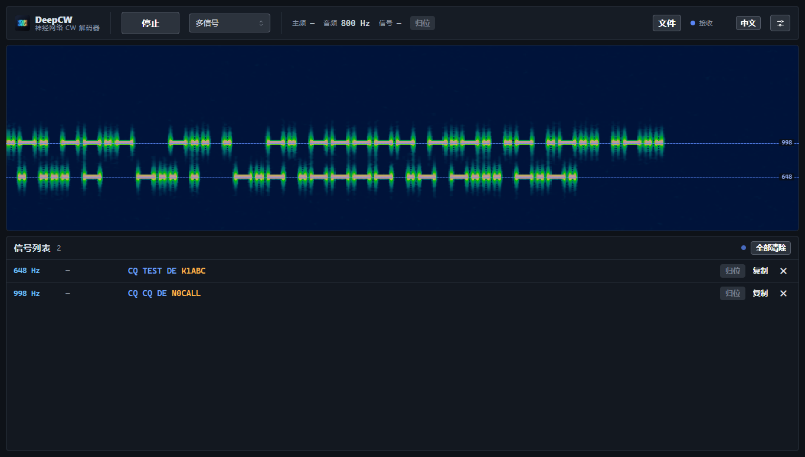

# DeepCW Desktop

Windows 桌面版的 [DeepCW](https://github.com/e04/web-deep-cw-decoder)：解码内核与模型完全沿用 e04 的官方神经网络 CW 解码器，在此基础上重做了界面（中英双语、标签式设置），并加入**电台 CAT 控制**和**比赛软件（N1MM / JTAlert / GridTracker）联动**，离线运行、装完即用。

[](https://github.com/dedadeda26/deepcw-desktop/releases) [](LICENSE)


## 功能

**解码**

- 质量预设：均衡（默认）/ 高精度 / 快速，模型与解码窗口（12 / 18 / 30 s）随之切换，并记住上次选择
- 带宽 100–800 Hz 可选，流式解码，开始后数秒出字
- 录音回放：拖入或打开 wav / mp3 / ogg / flac / m4a，首尾自动补静音
- 清空 / 复制 / 保存 / 时间戳 / 字号 / 窗口置顶

**多信号**

- 自动跟踪多条 CW，逐条显示频率与文字；文字持续累加并自动跟随最新字符
- 单条 QSY、单条清除、全部清除

**文字高亮**：呼号（金色）、599 / 5NN 信号报告（绿色）、CQ / DE / 73 等关键词（蓝色）

**电台与比赛**

- Kenwood / Elecraft、Yaesu、Icom CI-V，串口自动探测
- 频率联动，一键「归位」到 800 Hz
- WSJT-X UDP 输出，N1MM+ / JTAlert / GridTracker 可直接接收

**界面**

- 中文 / English 随时切换，深色方正风格
- 标签式设置页：常规 / 电台 / 音频 / 网络 / 显示 / 高级 / 关于
- 可选背景图（模糊、透明度、遮罩可调），窗口位置记忆

## 安装

1. 从 [Releases](https://github.com/dedadeda26/deepcw-desktop/releases) 下载 `DeepCW-Desktop-Setup-x.y.z.exe` 安装（Windows 10 / 11 x64），或直接运行免安装包里的 `DeepCW Desktop.exe`
2. 安装包使用自签名证书，Windows 提示“未知发布者”时选择“更多信息 → 仍要运行”
3. 点「开始」选择音频输入；没有电台也可以只用麦克风或录音解码



## 使用

1. 瀑布图上拖动蓝色频带选择解码频率，滚轮微调（按住 Shift 更细）
2. 接电台：设置 → 电台 →「自动探测」或手动选择串口 / 波特率 / 协议 → 连接
3. 联比赛软件：设置 → 网络，开启 WSJT-X UDP（默认 127.0.0.1:2237）
4. 一轮通联结束按「清空」开始下一轮，或「保存」导出文本

快捷键：`Ctrl+L` 清空 · `Ctrl+Shift+C` 复制 · `Ctrl+S` 保存 · `Ctrl+O` 打开录音 · `Ctrl+Enter` 开始/停止 · `Ctrl+T` 置顶 · `Ctrl+,` 设置 · `Esc` 关闭设置


## 从源码构建

```bash
cd app
npm ci
npm run build        # 前端
npm run desktop      # 开发运行
npm run dist:dir     # 免安装目录（最快，适合测试）
npm run dist         # NSIS 安装包
```

需要 Node 20+。安装包签名可选：`tools/make-signing-cert.ps1` 生成自签名证书，然后 `npm run dist:signed`（读取 `DEEPCW_CERT_FILE` / `DEEPCW_CERT_PASSWORD`）。

## 授权

- 解码引擎与模型：© 2026 **e04** — [web-deep-cw-decoder](https://github.com/e04/web-deep-cw-decoder) / [deepcw-engine](https://github.com/e04/deepcw-engine)，AGPL-3.0-only。模型文件为官方网页应用原样分发，版权归作者，仅供个人非商业离线使用，作者要求即移除。
- 本项目代码：AGPL-3.0，见 [LICENSE](LICENSE)；第三方库与字体见 [NOTICE.md](NOTICE.md)。
- 非官方封装，与原作者无隶属关系。
