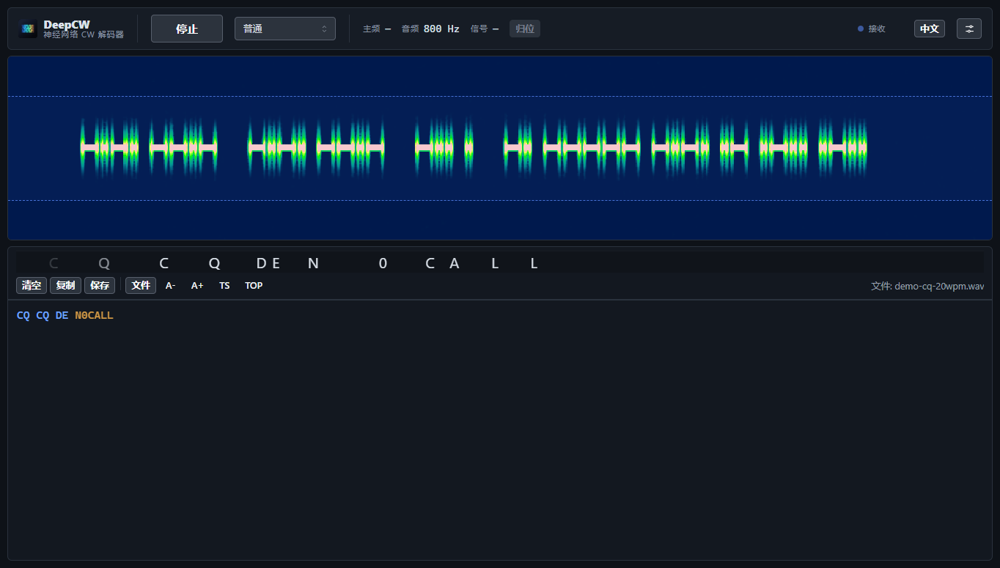
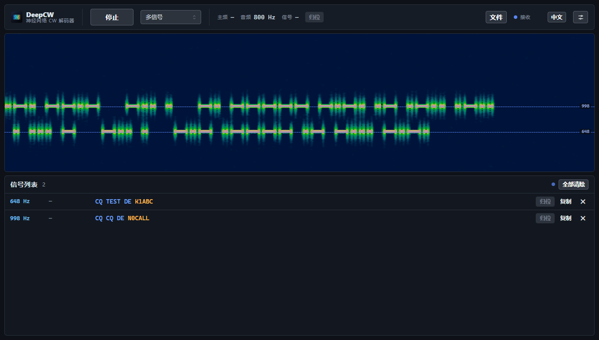
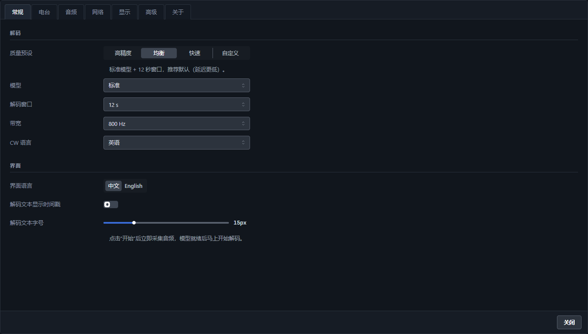

# DeepCW Desktop

Windows 桌面版的 [DeepCW](https://github.com/e04/web-deep-cw-decoder)：解码内核与模型完全沿用 e04 的官方神经网络 CW 解码器，在此基础上重做了界面（中英双语、标签式设置），并加入**电台 CAT 控制**和**比赛软件（N1MM / JTAlert / GridTracker）联动**，离线运行、装完即用。

[](https://github.com/dedadeda26/deepcw-desktop/releases) [](LICENSE)



## 功能

**解码**

- 质量预设：均衡（默认）/ 高精度 / 快速，模型与解码窗口（12 / 18 / 30 s）随之切换，并记住上次选择
- 带宽 50–1400 Hz 连续可调，流式解码，开始后数秒出字
- 录音回放：拖入或打开 wav / mp3 / ogg / flac / m4a，首尾自动补静音
- 清空 / 复制 / 保存 / 时间戳 / 字号 / 窗口置顶

**前端滤波（DSP 前处理）**

送进神经网络之前先做一遍确定性信号处理。开关就在顶部那条导航栏里：`DSP` 按钮一键开关，右边的小箭头展开选项；旁边的小图实时显示前端在锁定的音调上开了多宽的通带（虚线框＝你在瀑布图里选的解码频带），再往右是锁定状态与码速。

- 音调捕获与跟踪：投票式锁定 CW 音调，之后慢跟踪，换频 / 长时间无信号会自动重捕
- 自适应带通：带宽跟着码速走（约 4.5 × WPM，夹在 110–280 Hz），也可固定
- 噪声底跟踪 + Wiener 增益：只在噪声主导的频点上压，干净信号基本不动
- 静电 / 开关火花消隐（只削极短脉冲，不碰码元）、工频（50/60 Hz）陷波、常发载波自动陷波、带死区的 AGC（QSB 补偿）
- 三档强度（轻度 / 标准 / 强力），可选「只在所选频带内捕获音调」「带宽跟随码速」「始终介入」
- 默认策略很保守：判不准就直通（状态里会写「直通」），宁可不做也不误伤；想让它在邻台旁也硬上，打开「始终介入」
- 多信号模式不走这条单音前端；性能测试也自动旁路，保证数据可比

**多信号**

- 自动跟踪多条 CW，逐条显示频率与文字；文字持续累加并自动跟随最新字符
- 单条 QSY、单条清除、全部清除

**文字高亮**：呼号（金色）、599 / 5NN 信号报告（绿色）、CQ / DE / 73 等关键词（蓝色）

**电台与比赛**

- Kenwood / Elecraft、Yaesu、Icom CI-V，串口自动探测
- 频率联动，一键「归位」到 800 Hz
- WSJT-X UDP 输出，N1MM+ / JTAlert / GridTracker 可直接接收

**界面**

- 中文 / English 随时切换，深色方正风格
- 标签式设置页：常规 / 电台 / 音频 / 网络 / 显示 / 高级 / 关于
- 可选背景图（模糊、透明度、遮罩可调），窗口位置记忆

**自动更新**

- 通过 GitHub Releases 分发，不需要额外的更新服务器
- 启动后静默检查，发现新版本才询问；也可手动 帮助 → 检查更新 / 设置 → 关于 → 检查更新
- 下载完提示重启安装，选「稍后」则在退出时安装；过程记录在 `%APPDATA%/DeepCW Desktop/update.log`

## 安装

1. 从 [Releases](https://github.com/dedadeda26/deepcw-desktop/releases) 下载 `DeepCW-Desktop-Setup-x.y.z.exe` 安装（Windows 10 / 11 x64），或直接运行免安装包里的 `DeepCW Desktop.exe`；装好之后可以直接在应用内升级，不用再来下载
2. 安装包使用自签名证书，Windows 提示“未知发布者”时选择“更多信息 → 仍要运行”
3. 点「开始」选择音频输入；没有电台也可以只用麦克风或录音解码



## 使用

1. 瀑布图上拖动蓝色频带选择解码频率；拖动频带上/下边缘直接改变带宽（框会跟着缩放），滚轮微调频率（按住 Shift 更细）
2. 想更干净时点顶部导航栏的 `DSP`：右边的小图会显示前端实际开的通带，状态写「直通」说明它判断这块频带不需要动手（可展开选项打开「始终介入」）
3. 接电台：设置 → 电台 →「自动探测」或手动选择串口 / 波特率 / 协议 → 连接
4. 联比赛软件：设置 → 网络，开启 WSJT-X UDP（默认 127.0.0.1:2237）
5. 一轮通联结束按「清空」开始下一轮，或「保存」导出文本

快捷键：`Ctrl+L` 清空 · `Ctrl+Shift+C` 复制 · `Ctrl+S` 保存 · `Ctrl+O` 打开录音 · `Ctrl+Enter` 开始/停止 · `Ctrl+T` 置顶 · `Ctrl+,` 设置 · `Esc` 关闭设置



## 从源码构建

```bash
cd app
npm ci
npm run build        # 前端
npm run desktop      # 开发运行
npm run dist:dir     # 免安装目录（最快，适合测试）
npm run dist         # NSIS 安装包
```

需要 Node 20+。安装包签名可选：`tools/make-signing-cert.ps1` 生成自签名证书，然后 `npm run dist:signed`（读取 `DEEPCW_CERT_FILE` / `DEEPCW_CERT_PASSWORD`）。

## 授权

- 解码引擎与模型：© 2026 **e04** — [web-deep-cw-decoder](https://github.com/e04/web-deep-cw-decoder) / [deepcw-engine](https://github.com/e04/deepcw-engine)，AGPL-3.0-only。模型文件为官方网页应用原样分发，版权归作者，仅供个人非商业离线使用，作者要求即移除。
- 本项目代码：AGPL-3.0，见 [LICENSE](LICENSE)；第三方库与字体见 [NOTICE.md](NOTICE.md)。
- 非官方封装，与原作者无隶属关系。
