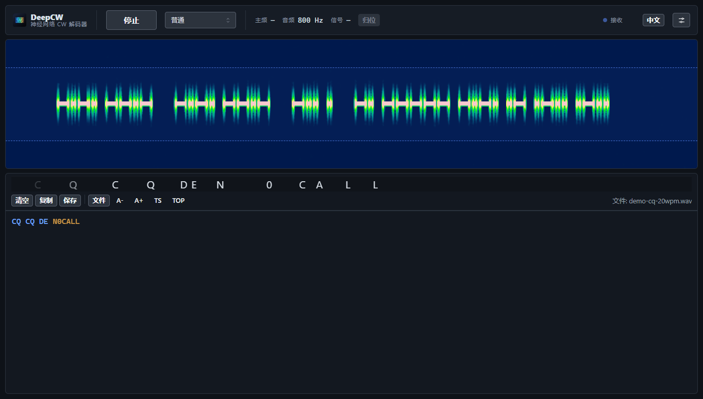
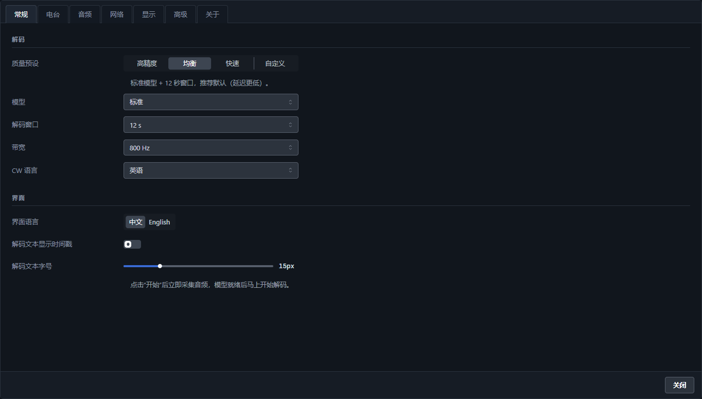
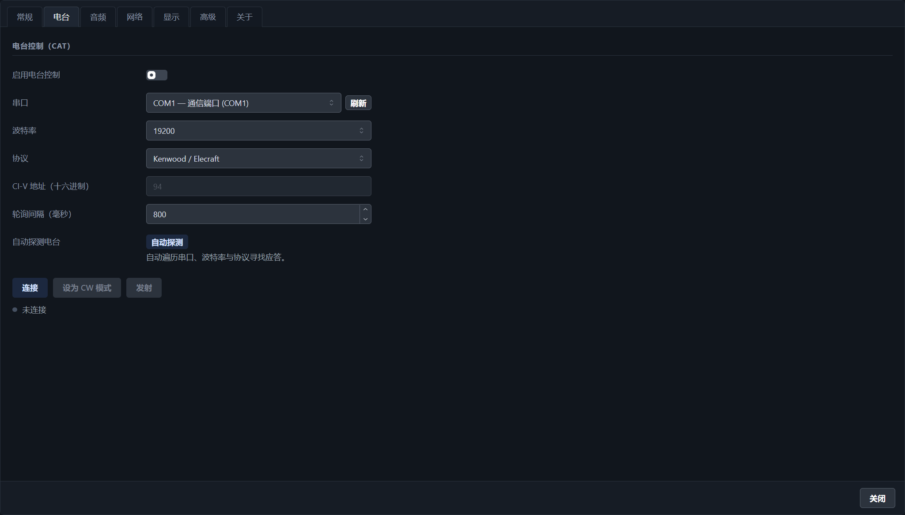

# DeepCW Desktop（本地桌面版）

把 GitHub 上的 [DeepCW](https://github.com/e04/web-deep-cw-decoder)（e04 的神经网络摩尔斯/CW 解码器）从"只能在浏览器里用"的网页应用，改造成**离线、可安装、面向比赛场景的 Windows 桌面软件**。

> 解码引擎与模型仍是官方的（网页同款 WASM 引擎 + 官方模型文件），解码质量与原网页一致；外壳、界面、电台控制与网络转发是本项目的改动。

[](https://github.com/dedadeda26/deepcw-desktop/releases) [](LICENSE)



---

## 1. 功能一览

### 解码

| 项目 | 说明 |
| --- | --- |
| 质量预设 | **均衡（默认）** = 标准模型 + 12 s 窗口；高精度 = 标准 + 18 s；快速 = 微型 + 12 s；全部记忆上次选择 |
| 解码窗口 | 清空 / 复制 / 保存 / 字号 / 时间戳 / 置顶，均可随时使用 |
| 多信号 | 自动检测多条 CW，**独立信号列表**逐条显示频率+文本，文字像单信号一样**持续向后累加**（不会随窗口滚走），超出宽度时自动横向跟随最新字符；支持**单条清除**和**全部清除** |
| 重点高亮 | 解码文字里自动上色：**呼号**（金色）、**信号报告 599/5NN**（绿色）、**CQ/DE/73/TEST** 等常用词（蓝色） |
| 频谱交互 | 瀑布图上**按下即拖动**实时调整解码带（无需松手），滚轮微调 20 Hz（Shift 5 Hz） |
| 录音回放 | 「文件」或直接拖入 WAV/MP3/OGG/FLAC/M4A，首尾自动补静音，播完自动收尾 |
| 启动速度 | 开始采集后**约 3.8 s** 出现第一批字符（13 s 测试录音，均衡档） |

### 比赛 / 电台

| 项目 | 说明 |
| --- | --- |
| 电台控制 | Kenwood/Elecraft、Yaesu、Icom CI-V；串口/波特率/CI-V 地址可配；轮询 VFO |
| CAT 自动探测 | 自动遍历串口、波特率、协议寻找应答电台，找到即填入配置并连接 |
| 频率联动 | 顶栏 主频 / 音频偏移 / 绝对频率；「归位」把信号移到 800 Hz 音调位置 |
| WSJT-X UDP | 向 N1MM+ / JTAlert / GridTracker 广播 Status / Decode / Heartbeat / Clear（默认 127.0.0.1:2237，可广播） |

### 界面 / 语言

| 项目 | 说明 |
| --- | --- |
| 风格 | 方正、扁平、深灰底 + 蓝色强调，主界面只保留「顶栏 / 瀑布 / 解码」三块 |
| 设置 | 独立整页、标签式（常规 / 电台 / 音频 / 网络 / 显示 / 高级 / 关于），参考 JTDX、WSJT-X |
| 中文 | 完整简体中文界面，可随时切换 English；Windows 中文系统默认中文 |
| 背景图 | 可选背景图，含模糊 / 不透明度 / 暗色遮罩 / 面板不透明度四个滑杆 |
| 窗口 | 默认 1440×900，最小 1100×640，位置/大小记忆 |

## 2. 快速使用

```
测试版（免安装，直接运行）：D:\DeepCW_desktop\dist-exe\win-unpacked\DeepCW Desktop.exe
安装包（需要时再打）：      D:\DeepCW_desktop\dist-exe\DeepCW-Desktop-Setup-<版本>.exe
```

1. 点「开始」→ 选音频输入设备（设置 → 音频，任何时候都能改）。
2. 瀑布图上拖动蓝色带选择解码频率；滚轮微调。
3. 接电台：设置 → 电台 → 「自动探测」或手动选串口/波特率/协议 → 连接。
4. 联 N1MM：设置 → 网络 → 打开 WSJT-X UDP（默认 2237 端口）。
5. 收到呼号后按「清空」开始下一轮，或用「保存」导出文本。

快捷键：Ctrl+L 清空 · Ctrl+Shift+C 复制 · Ctrl+S 保存 · Ctrl+O 打开录音 · Ctrl+Enter 开始/停止 · Ctrl+T 置顶 · **Ctrl+, 设置** · Esc 关闭设置。

## 3. 设置页



- **常规**：质量预设、模型、解码窗口、带宽、CW 语言、界面语言、时间戳、字号。
- **电台**：启用、串口、波特率、协议、CI-V 地址、轮询、自动探测、连接、设 CW、PTT。
- **音频**：输入设备（随时可换）、监听输出（THRU）。
- **网络**：WSJT-X UDP 开关、主机、端口、广播、测试报文。
- **显示**：背景图与四个滑杆。
- **高级**：打开数据目录、重置所有设置。
- **关于**：版本与授权信息。

## 4. 从源码构建

内置便携 Node（`tools/node-v22.14.0-win-x64`）：

```powershell
$env:Path = "D:\DeepCW_desktop\tools\node-v22.14.0-win-x64;" + $env:Path
cd D:\DeepCW_desktop\app
npm ci
npm run build        # 前端
npm run desktop      # 开发运行
npm run dist:dir     # 只打免安装目录 dist-exe\win-unpacked（测试用，最快）
npm run dist         # NSIS 安装包（未签名）
npm run dist:signed  # NSIS 安装包（使用 DEEPCW_CERT_FILE 证书签名）
```

**代码签名**（可选）：`tools\make-signing-cert.ps1` 生成自签名证书（需管理员权限把证书装入“受信任的根证书颁发机构”），随后：

```powershell
$env:DEEPCW_CERT_FILE = "D:\DeepCW_desktop\app\build\signing.pfx"
$env:DEEPCW_CERT_PASSWORD = "deepcw-local"
npm run dist:signed
```

> 自签名证书只对安装了该证书的机器有效；对外分发请换成正式代码签名证书（OV/EV）。

## 5. 目录结构

```
D:\DeepCW_desktop\
├─ app\                     ← 工程（网页版源码 + 改为桌面版的改动）
│  ├─ src\                  ← React 界面（i18n、设置页、信号列表、背景、电台/UDP 集成）
│  ├─ electron\main.cjs     ← 主进程：静态服务、菜单（中英）、对话框、背景图、IPC
│  ├─ electron\rig.cjs      ← Kenwood / Yaesu / Icom CI-V + 自动探测
│  ├─ electron\wsjtx.cjs    ← WSJT-X UDP 编码（schema 3）
│  ├─ public\engine\        ← 官方 WASM 引擎
│  ├─ public\models\        ← 官方模型容器
│  └─ build\signing.pfx     ← 本机自签名证书（不要外传）
├─ dist-exe\                ← 测试目录 win-unpacked\ / 安装包
├─ docs\                    ← 截图
├─ tools\                   ← 便携 Node、测试音频生成、验证/签名脚本
└─ README.md
```

## 6. 实现要点

- **本地 HTTP 服务**：引擎 WASM 需要 `SharedArrayBuffer`（COOP/COEP），服务固定监听 `127.0.0.1:17321`（被占用时回退随机端口），保证设置能跨启动保留。
- **多信号**：使用引擎自带的检测/跟踪（`detectCwBins` + tracker）与 `runMultiInference`（narrow 模型），界面只负责展示与操作。
- **WSJT-X UDP**：按 wsjtx `NetworkMessage` 格式（大端 QDataStream、长度前缀 UTF-8、schema 3）编码；Status 带主频、Decode 带音频偏移。
- **CAT**：ASCII 协议按 `;` 分帧，Icom 处理 BCD 与 `FE FE … FD` 帧；PTT 有 60 s 安全释放；自动探测会遍历 串口 × 波特率 × 协议。
- **启动速度**：模型在应用启动时就预加载；开始按钮不再等待模型；窗口预览推理限流 700 ms；流式首段上下文从 4 s 降到 3 s。
- **多信号增量文字**：每条信号单独解码（频带平移到模型中心），用「音频绝对采样时钟 + 文本对齐」提交字符：只有落在 1.2 s 保护窗之外、且尚未出现在已提交文本里的字符才会追加，因此文字只向前生长，不会随窗口滑动重写或重复。

## 7. 验证结果（0.9.3）

| 检查项 | 结果 |
| --- | --- |
| 中文界面 | Windows 中文系统默认 `zh-CN`，可切 English |
| 默认档位 | 均衡（标准模型 + 12 s 窗口），带宽 800 Hz |
| 解码演示录音 | `CQ CQ DE N0CALL`（与原文一致） |
| 首字符延迟 | **3.8 s**；13 s 录音 11.5 s 全部解完 |
| 重点高亮 | `CQ / DE / TEST` 蓝色、`N0CALL / K1ABC` 金色，单信号与多信号列表均生效 |
| 瀑布拖动 | 拖动过程中频率实时变化（800 Hz → 333 Hz 连续跟随） |
| 设置页 | 7 个标签页正常切换，音频设备在未开始时即可见/可选 |
| 多信号 | 双信号（648/998 Hz）持续累加为 `CQ TEST DE K1ABC` / `CQ CQ DE N0CALL`，无重复无回退 |
| 多信号清除 | 行内 ✕ 只清该条；「全部清除」清空所有文本（已消失的信号行同时移除） |
| 行内横向滚动 | 文本超出宽度时自动滚到最新字符（实测 5570 px 内容滚到最大位置） |
| 频带把手 | 鼠标不在瀑布图上时把手 opacity 0，悬停/拖动才显示，不再遮挡频谱 |
| 窗口尺寸 | 1100×640 与 1440×900 下顶栏均为单行、无溢出（窄窗口自动隐藏主频/信号/进度条） |
| 串口 | COM1 / COM3 枚举正常；错误端口返回明确错误 |
| CAT 自动探测 | 遍历结束无应答时给出“未找到有响应的电台” |
| WSJT-X UDP | 本地监听收到 Heartbeat / Status / Decode（magic `0xadbccbda`，schema 3） |
| NSIS 安装包 | 已生成并通过签名流程（自签名）；便携单文件版已按要求移除 |



## 8. 已知问题

- **CAT 未接真机验证**：本机 COM3 被其它程序占用，只验证了打开/轮询/断开/错误处理与自动探测流程；不同 Yaesu 型号的 9 位频率等细节可能需微调。
- **N1MM 未实机联调**：UDP 报文按 wsjtx 规范编码并用监听器验证，未装 N1MM+ 做端到端确认。
- **自签名证书**：签名流程可用，但根证书未装入受信任存储（需管理员），因此 SmartScreen 仍会提示；正式分发需购买代码签名证书。
- 模型是官方加密容器，仅原样分发、仅供个人离线使用；引擎/模型版权归 e04（引擎 AGPL-3.0）。
- 流式解码天生有 3 s 左右延迟（首段需要上下文），无法做到“即时出字”。

## 9. 改进建议

1. N1MM 反向联动（监听 Reply/QSOLogged：点 spot 即 QSY、自动填呼号）。
2. CW 拍发（WinKeyer / 串口键控）与 F1–F8 消息键。
3. 比赛日志导出（Cabrillo/ADIF）与录音存档、事后重解。
4. 多信号列表支持“锁定/取消锁定”和按信噪比排序。
5. 呼号高亮接入内置呼号库/CTY 数据库，区分本国/国外台并按分区上色。

## 10. 版权与授权

- **解码引擎 / 模型 / 原始网页界面**：© 2026 **e04**
  - [web-deep-cw-decoder](https://github.com/e04/web-deep-cw-decoder)（AGPL-3.0-only）
  - [deepcw-engine](https://github.com/e04/deepcw-engine)（AGPL-3.0-only）
  - `app/public/engine/` 与 `app/public/models/` 是官方网页应用**原样**分发的文件（模型容器带有 `COPYRIGHT@2026 E04` 头），版权归作者，**不在本仓库授权范围内**，仅随应用提供以便离线运行、仅供个人非商业使用；作者如要求移除，会立刻删除。
- **本仓库其他代码**（Electron 外壳、界面、CAT、WSJT-X UDP、中英双语、构建/签名脚本）：**AGPL-3.0**，见 [LICENSE](LICENSE)。
- 第三方库与字体清单见 [NOTICE.md](NOTICE.md)。

> 本项目是非官方封装，与原作者无隶属关系。
